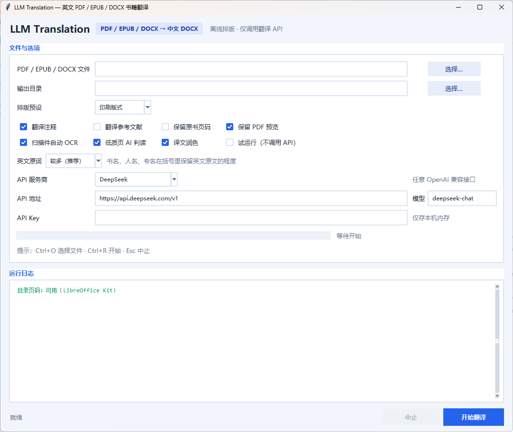

# LLM-Translation (`llmtr`)

把**带文字层的英文 PDF / EPUB / DOCX** 译成排版好的中文 DOCX。一条命令走完全程：

```bat
llmtr run book.pdf  --out out\book
llmtr run book.epub --out out\book
llmtr run book.docx --out out\book
```

Windows 用户可直接从 [Releases](../../releases) 下载 `LLMTranslation_Setup_1.2.0.exe`，
双击安装即可使用。安装包已内置 Node 和 LibreOffice Kit，不需要安装 Python、Office、
LibreOffice 或其他运行环境。



## 安装

源码运行：

```bat
pip install -r requirements.txt
set DEEPSEEK_API_KEY=<your-api-key>
```

安装包自带 LibreOffice Kit，DOCX 转 PDF、预览 PDF 和目录页码回填开箱即用。
源码运行时，把 Node + Kit 放到 `vendor/libreoffice-kit/`（`node.exe` 与
`node_modules/@deepseek-ai/libreoffice-kit/lib/cli.js`）即可；也可以用
`config/config.json → figures.node / figures.cli` 指定已有路径，或改由本机
LibreOffice / Word / WPS 兜底。

## 命令

```bat
llmtr probe book.pdf                     :: 只判断能否处理（扫描件返回码 2）
llmtr run   book.pdf --out out\book      :: 全流程
llmtr run   book.pdf --preset print      :: 换排版预设
llmtr run   book.pdf --pages 9-12        :: 只译一段，抽样验收
llmtr run   book.pdf --dry-run           :: 不调 API，联调流水线
llmtr run   book.pdf --no-toc            :: 关掉目录驱动的结构识别
llmtr build out\book\book.json --out x.docx --preset large
```

## 桌面版（免安装）

```bat
python -m PyInstaller LLMTranslation.spec
```

生成 `dist\LLMTranslation\LLMTranslation.exe`（onedir，`config` 随包）。界面与命令行同一套流水线；
勾选“扫描件自动 OCR”“低质页 AI 判读”即可处理带 OCR 图层的扫描书，完成后可直接打开 DOCX、
校对报告或输出目录。也支持命令行预填并自动开始：

```bat
LLMTranslation.exe --pdf book.pdf --out out\book --preset print --start
```

## Windows 安装包

`LLMTranslation_Setup_1.2.0.exe` 是免环境的一键安装包（NSIS，按当前用户安装，不需要管理员权限）：

- 安装到 `%LOCALAPPDATA%\Programs\LLM Translation`，约 380 MB，包含 Python、PyMuPDF、python-docx、Pillow、Node 以及完整的 LibreOffice Kit 引擎；
- 自动创建桌面、开始菜单快捷方式，并写入标准卸载注册表项（设置 → 应用 → 已安装的应用可看到）；
- 卸载时可选择“保留配置和缓存”或“全部删除”（静默卸载默认保留，`/DELETEALL` 强制清空）；
- 安装包与程序均未使用 UPX 壳，降低杀毒软件误报概率；但未购买代码签名证书，SmartScreen 仍可能提示“未知发布者”。

重新构建安装包（NSIS 在含中文的路径下无法写输出，需先复制到纯英文目录）：

```bat
python -m PyInstaller LLMTranslation.spec
:: 将 dist\LLMTranslation、assets、installer、vendor\libreoffice-kit
:: 复制到 D:\build 下对应位置
C:\nsis\Bin\makensis.exe D:\build\installer\LLMTranslation.nsi
```

构建暂存目录用纯英文路径（如 `D:\build`），构建完成后可整体删除，不要留在 C 盘。

LibreOffice Kit 的原生引擎无法从含中文的路径启动，因此安装包把它装到
`C:\ProgramData\LLMTranslationKit`（与用户名、安装目录无关的纯英文路径），
程序启动时优先从那里加载；源码运行时则先找 `vendor/libreoffice-kit`。

安装包内的 `使用说明.txt` 面向非技术用户，安装完成页和开始菜单均可打开。

## 流水线

| 阶段 | 模块 | 做什么 |
| --- | --- | --- |
| 探针 | `ingest.probe` | 判有无文字层；无则拒绝并提示先做 OCR |
| 结构化 | `ingest.build_ir` | 去页眉、拼跨页段、按缩进切段、识别章/节/注/文献/索引 |
| EPUB | `epub.extract` | 逐页 XHTML → 同一套块结构：字号定标题层级、红色页码标签、`<sup>` 注号、内嵌图片按原位保留；跳过封面/版权/目录页 |
| DOCX | `docxin` | 无头转 PDF（内置 kit / LibreOffice / Word·WPS COM）后走同一套 PDF 流程；同时读 Word 的 `Heading 1-3` 大纲盖回块结构，元数据取文档属性，文首标题/署名并入封面 |
| 跨版拆分 | `ocr.layout_pages` | 文字层不可用时整页视觉识别；扫描件一页拍两页（宽高比 ≥1.2）时按左右半页分别识别，各自保留印刷页码 |
| 目录驱动 | `toc` | 先认目录页（`Contents`/`目录`/点线引导/右对齐页码，含跨页与双栏）→ 章节标题与页码 → 注入 `h1`（按页）/`h2`（按标题前 5 词定位），剥离段落里粘连的标题文字；目录页解析不可靠时改用 PDF 书签；都没有则按版式（字号、缩进、页首短行）自识别标题层级 |
| 翻译 | `translate` | 1600 词 / 7000 字符一片、`[b0001]` 编号协议、输出上限 8192 token；截断尾行自动重打、整批失败逐块补译、磁盘缓存可续跑；术语表按片裁剪下发；按“英文原词”档位下发不同的书名/专名括注规则 |
| 润色 | `translate.polish_blocks` | 二次中文编辑：拆分“的”字链、去空动词与生硬“被”字句；数字、注号、外文与篇幅受硬性校验，越界改写丢弃 |
| 修复 | `translate.repair_blocks` 等 | 标题回炉；篇幅异常/疑似截断的段落整段重译；夹带在中文里的英文单词就地汉化 |
| 人名 | `names` | 专名候选 → 一次批量译名 → 正文替换 + `中文（English)` 首现括注（适度按全书、较多按每章、关闭不加）→ 书末人名索引（按英文排序、变体合并） |
| 英文原词 | `gloss` | 按档位统一括注：术语表命中的专名、机构、关键概念补 `中文（English）`；重复的书名原文括注只保留每章第一处；关闭档全部去掉 |
| 图版 | `figures` | 版式统计挑出候选页；**只转换确认页**（`force`），候选页只报告，避免误伤正文；渲染→裁白边→转正→嵌图→图注带原书页码 |
| 表格 | `tables` | 定位表格区域 → 按原书版面渲染为图片嵌入 DOCX（不再重建表格结构），跨页续表附原书页码 |
| 清洗 | `clean` | 去前置件、碎片、OCR 残符；标题合法性校验（无中文即伪标题）、重复标题剥离、跨页标题碎片合并 |
| 排版 | `build` | 三套预设（正文两端对齐）；封面/目录/正文三节；页码域；章间细线；图版、表格、注释、文献样式 |
| 目录页码 | `pipeline.paginate` | 出稿→转 PDF→读书签大纲→回填译本页码→再编译，校验零漂移 |

## 配置

`config/config.json`（全局）+ `config/figures.json`（图版）+ `config/glossary.tsv`（术语）+ `config/names.tsv`（人名）。

```json
{
  "api": {"base_url": "https://api.deepseek.com/v1", "model": "deepseek-chat", "workers": 4},
  "preset": "print",
  "page_tags": false,
  "copyright_page": true,
  "odd_even_header": true,
  "ocr": {"mode": "auto", "spread": "auto", "judge": true, "judge_max": 40},
  "translate": {"notes": true, "bibliography": false},
  "polish": {"enabled": true, "batch_chars": 6000, "max_blocks": 8},
  "names": {"enabled": true, "limit": 150},
  "source_gloss": {"mode": "strong", "max_per_block": 8},
  "figures": {"mode": "auto", "force": [], "rotate": {}, "captions": {}}
}
```

`figures.force` / `rotate` / `captions` 是**逐书**人工覆盖项，默认留空；通用默认值里不要放某本书的页码。
`ocr.spread`：`auto`（默认，宽高比 ≥1.2 且整页为栅格图时按跨版拆分）/ `force` / `off`。

`ocr.judge`：文字层整体可用时，仍对疑似粘连页逐页做 AI 判读（默认开）；`judge_max` 限制单次判读页数。
判读以 `[OK]` / `[FIX]+结构化重排` 回复，只有 `[FIX]` 的页会覆盖原 OCR 文本，其余原样保留。

`figures.mode`：`auto` 只转 `force` 里的页；`auto-all` 连候选页一起转；`off` 关闭。

## 英文原词对照

译稿里保留多少英文，由 `source_gloss.mode`（GUI 的“英文原词”下拉框）控制：

| 档位 | 书名 | 人名 | 机构、地名、条约、关键术语 |
| --- | --- | --- | --- |
| `strong`（默认，较多） | 每章首次出现都写《中文书名》（English Title），之后只写中文 | 每章首次出现括注原文，优先用全名 | 首次出现括注原文 |
| `light`（适度） | 全书首次出现括注，之后只写中文 | 全书首次出现括注 | 只在没有把握时保留英文 |
| `off`（关闭） | 只写中文书名，并清掉已有括注 | 只写中文名，不加原文 | 一律译成中文 |

`strong` 还会对**术语表命中项**做确定性括注：只要该词在译文里出现且尚未括注，就补一个
`中文（English）`；同一作用域内每个词只补一次，`max_per_block` 限制单段最多补几处（默认 8）。
人名和术语的“首次”在 `strong` 下按章重置，`light` 下按全书只算一次。

书名括注由模型按上述规则生成；若某本书的书名反复出现且写法不统一，可在
`config/glossary.tsv`（或输出目录的 `glossary.tsv`）里加一行 `English Title<TAB>中文书名`
固定译法，翻译和括注都会以它为准。

接口按 OpenAI 兼容协议调用，`base_url` / `model` 可指向任意厂商（DeepSeek、OpenAI、通义千问、智谱、
自建 vLLM 等）；GUI 内置上述预设，也可选"自定义"。`price_in` / `price_out`（元/百万 token）只影响
费用估算；`headers` 可追加自定义请求头。

## 排版预设

| 预设 | 场景 | 要点 |
| --- | --- | --- |
| `screen` | 屏幕滚动 | 微软雅黑 11 pt / 1.6 / 两端对齐 / 章间细线不分页 |
| `print`（默认，校样） | 打印校样 | 宋体 10.5 pt / 两端对齐 / 首行缩进 2 字符 / 章另页 / 隐藏原书页码标记 / 版权占位页 / 奇偶页眉 / 页脚“第 N 页” |
| `large` | 长时间阅读 | 微软雅黑 13 pt / 1.85 / 两端对齐 / 段后 11 pt |

## 校样级输出

默认即按校样排版：正文页码标记隐藏（GUI 可勾选“保留原书页码”还原）、版权占位页、奇偶页眉
（单页章名 `STYLEREF`、双页书名）、页脚“第 N 页”、图版 300 dpi、图表编号与正文交叉引用、
原文注号锚定的真 Word 脚注、人名索引页码按译本回填、目录页码回填。

每次运行在输出目录生成 `proof_report.md` 与 `proof_report.csv`（UTF-8-SIG），逐项列出：
版面检查（页眉/版权页/图片分辨率）、OCR 质量（整本识别、损坏页、AI 判读的保留/重排/未定/跨版跳过）、
脚注锚定（同页/邻页/页末兜底/未挂接/章末注/无条目注号）、图与表（数量、重号）、规则体检、
AI 审校（自动修正与待复核），末尾给出能否交付人工通读的结论；OCR 判读结果在 CSV 中以 `kind=ocr` 逐页留痕。

## 扫描件 OCR 分级

带 OCR 文字层的纸质书扫描件分三档处理，避免"整本重识别"的高成本：

| 判定 | 条件 | 处理 |
| --- | --- | --- |
| 整本不可用 | 去掉空白后字符过少、中位词长 >9 或大面积粘连 | 整本 `ocr.layout_pages` 视觉结构化重排 |
| 单页损坏 | 页面字符数低于 `min_chars`（默认 120），且坏页比例未超阈值 | 只对坏页 `layout_pages(only=…)` |
| 单页可疑 | 词间空格丢失形成的粘连词（如 `coercedJordan…`、`thebeginningof`） | 逐页 `review_pages` 交模型判读：`[OK]` 保留原文字层，`[FIX]` 按图像重排 |

判读只发生在通过整体质量检查的书上；疑似页默认最多 `judge_max` 页，跨版页直接跳过。单页成本约
¥0.003–0.004，一本 300 页的书通常只有个位数页面进入判读。

## 目录

```
src/llmtr/   ingest / epub / docxin / toc / translate / names / gloss / figures / tables / clean / build / pipeline / cli
config/      config.json figures.json glossary.tsv names.tsv
tests/       test_units.py（离线单测）；test_baseline.py 需自备 fixtures/baseline/source.pdf
installer/   NSIS 安装脚本与面向非技术用户的使用说明
assets/      应用图标
out/<book>/  book.json  cache/  assets/  preview.pdf  *.docx（运行产物，不入库）
```

版权样例书、构建产物、翻译输出和内部一次性补丁脚本不随仓库分发，详见 `.gitignore`。

## 测试

```bat
cd tests
python -m unittest test_units        :: 快速单测：目录/版式/页码/翻译/排版（离线，<2s）
python -m unittest test_baseline     :: 基线书回归；缺少 source.pdf 时自动跳过
```

测试通过 `tests/_bootstrap.py` 自动加入 `src`，无需安装项目本身。

## 许可证

本项目以 **AGPL-3.0** 发布，完整条款见 [LICENSE](LICENSE)。运行时依赖 [PyMuPDF](https://pymupdf.readthedocs.io/)
采用 AGPL-3.0 / Artifex 商业双许可；本项目已按 AGPL-3.0 公开源码，安装包与源码一同发布。
若你需要在闭源产品中使用，请自行向 Artifex 购买商业许可。其余依赖及许可证见 [THIRD_PARTY_NOTICES.md](THIRD_PARTY_NOTICES.md)。

## 视觉（可选，建议开启）

同一端点即支持图片输入（`input_modalities: ["text","image"]`），因此图版判定与图注不再依赖手工配置：

| 用途 | 调用 | 说明 |
| --- | --- | --- |
| 图版确认 | `vision.classify` | 候选页发给模型 → `plate / table / text`，只转真正的图版页 |
| 自动图注 | `vision.caption` | 读页面上的图题/图例，产出中文图注（≤30 字） |
| 烂页转写 | `vision.transcribe` / `vision.transcribe_layout` | 缺失损坏页与 `[FIX]` 判读页按图像结构化重排 |

成本约 **¥0.003–0.004/页**，只对候选页调用（一本书通常 2–5 页，≈¥0.01）。
`config/figures.json` 的 `force` / `captions` 退化为人工覆盖项，不再是必需。

## 已知限制

1. 目录识别先找原书目录页（`Contents`/`目录`、点线引导、右对齐页码；支持跨页、双栏、OCR 基线抖动），
   解析不可靠时改用 PDF 书签；两者都没有才按字号/缩进/页首短行自识别，章标题可能少于原书目录。
2. 表格按原版面渲染成图片嵌入，不再在 Word 里重建单元格；扫描件若版式分析漏检，可用 `tables.mode` 调整。
3. 脚注依赖字号与版面线索；低质量扫描件仍可能漏注，整页视觉识别是效果最好但最贵的路径。
   OCR 判读只修复"粘连"这类可自动识别的坏页；语义层面的漏字/错字仍以报告中的未定页清单提示人工核对。
4. 图版若被旋转扫描，需在 `figures.rotate` 指定角度（视觉模型能判内容，但不会自动转正）。
5. EPUB 仅支持图文 EPUB（XHTML 逐页排版，如"页面对应一本印刷书"的转换版）；流式重排的 EPUB 结构线索弱，
   标题层级可能不准。
6. DOCX 的版面以内置 LibreOffice Kit 转出的 PDF 为准：缺字体或分页差异会影响图版/表格定位；
   标题层级优先取 `Heading 1-3` 样式，未用样式的标题仍按字号启发式。
7. 跨版拆分按几何比例判定；极少数"横排单页大图"可能误判为跨版，可用 `ocr.spread: "off"` 关闭。
